<div align="center">


# Skycast°

**A weather app that prints the sky as a poster.**

Search any city and the page sets itself in the colours of that sky right now: current conditions,<br />
a 36-hour meteogram, a 5-day outlook, daylight and air quality, all in the location's local time.

[](https://react.dev)
[](https://www.typescriptlang.org)
[](https://vite.dev)
[](https://vitest.dev)
[](https://openweathermap.org/api)
[](#how-it-works)

[Screenshots](#screenshots) · [Features](#features) · [Getting started](#getting-started) · [How it works](#how-it-works) · [Design](#design)

<br />

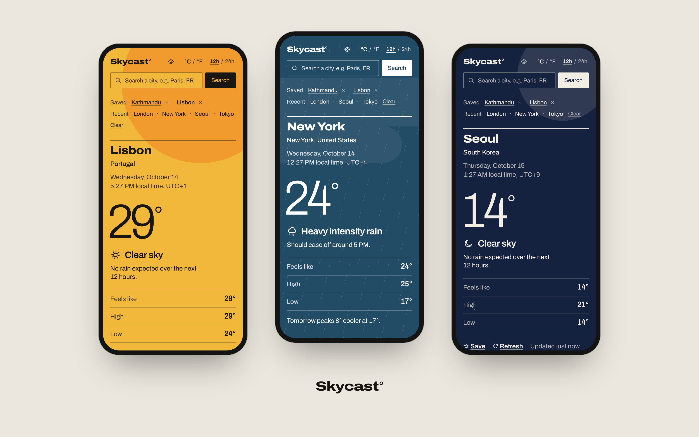

</div>

## The idea

Skycast follows the Swiss / International Typographic Style. Each forecast is laid out like a screen-printed poster: one flat field colour, a small set of inks, the temperature set as the image, and a strict grid. The palette comes from the actual conditions, so sunny Lisbon prints in yellow with a cropped orange sun, rainy New York in steel blue with fine rain hatching, and Seoul at night in navy under a pale moon.

<p align="center">
  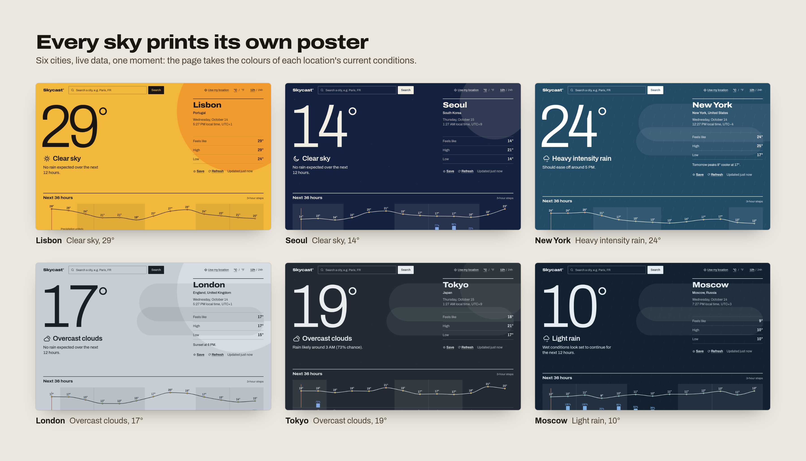
</p>

<p align="center">
  
  
  
  
  
  <br />
  
  
  
  
  
</p>

## Screenshots

All screenshots use live OpenWeather data, captured on 14 October 2026.

<table>
  <tr>
    <td width="50%">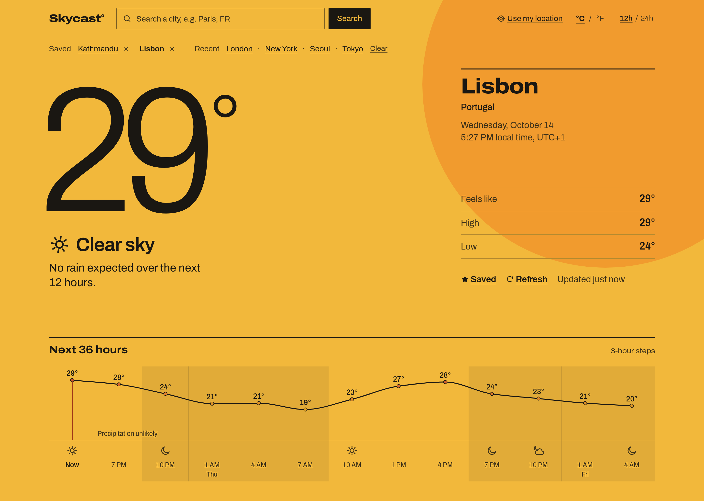</td>
    <td width="50%">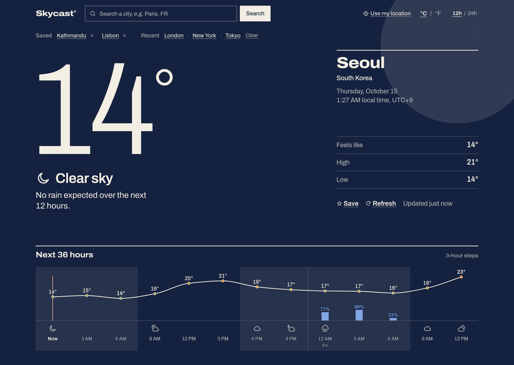</td>
  </tr>
  <tr>
    <td align="center"><sub>Clear day: Lisbon</sub></td>
    <td align="center"><sub>Clear night: Seoul</sub></td>
  </tr>
  <tr>
    <td>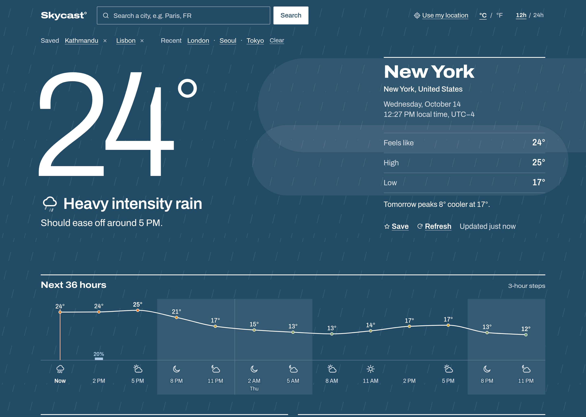</td>
    <td>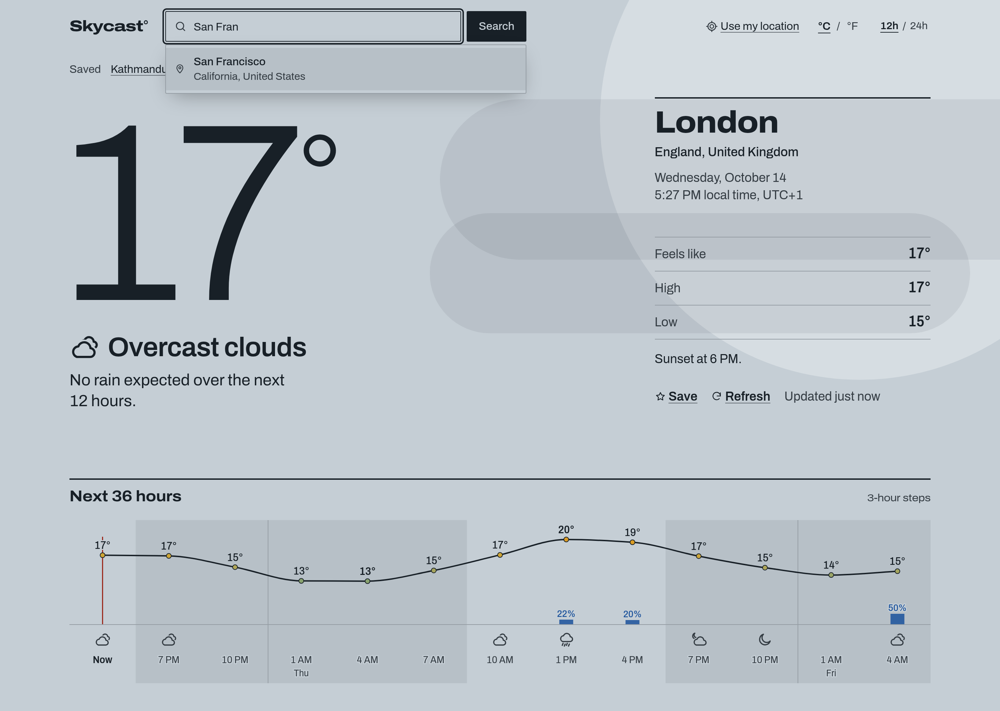</td>
  </tr>
  <tr>
    <td align="center"><sub>Rain: New York</sub></td>
    <td align="center"><sub>City search with suggestions</sub></td>
  </tr>
</table>

<table>
  <tr>
    <td width="33%">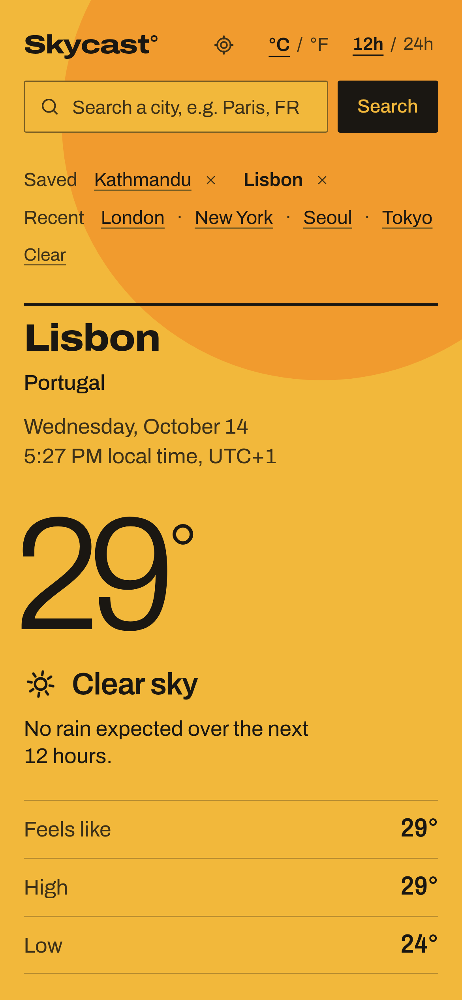</td>
    <td width="33%">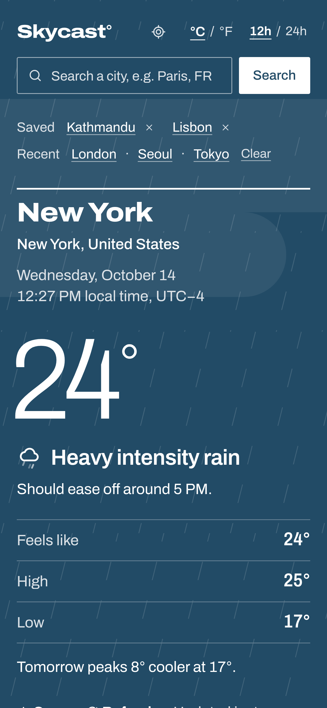</td>
    <td width="33%">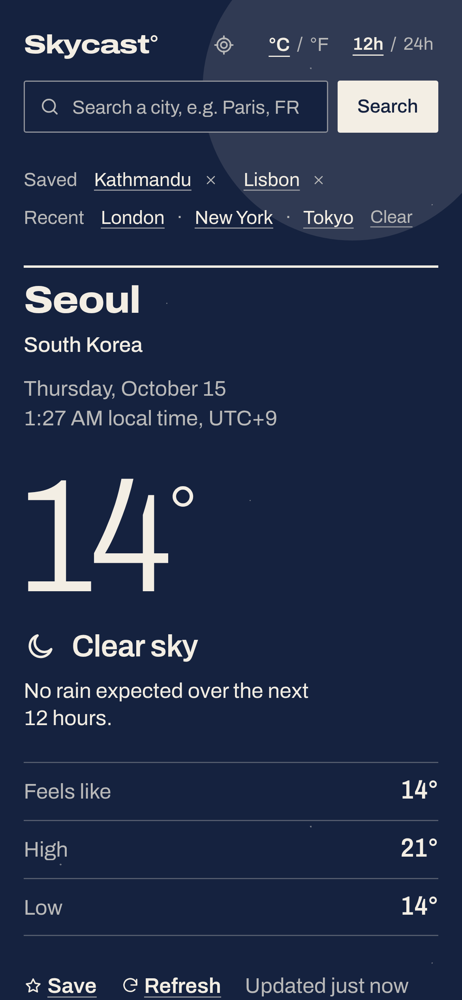</td>
  </tr>
</table>

<details>
<summary><b>More: detail views, tablet and the full page</b></summary>
<br />

<p align="center">
  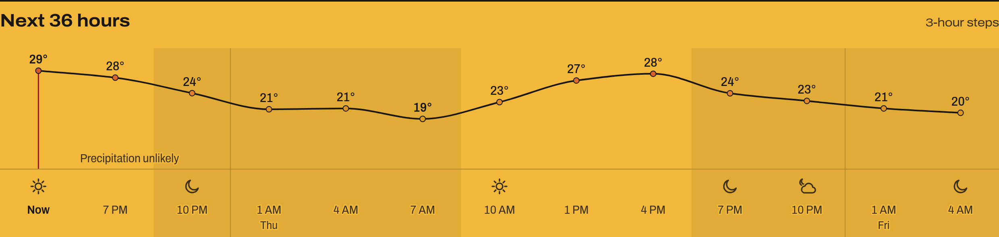
</p>
<p align="center">
  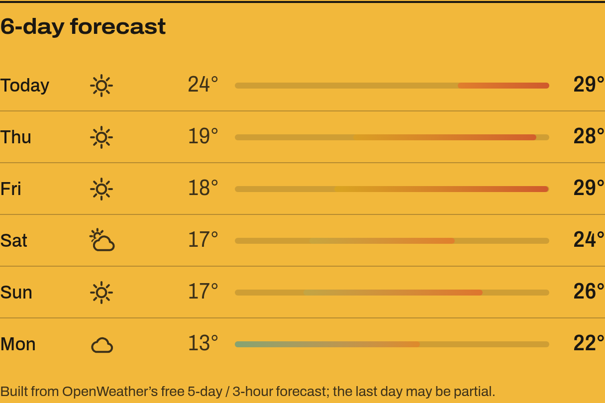
</p>
<p align="center">
  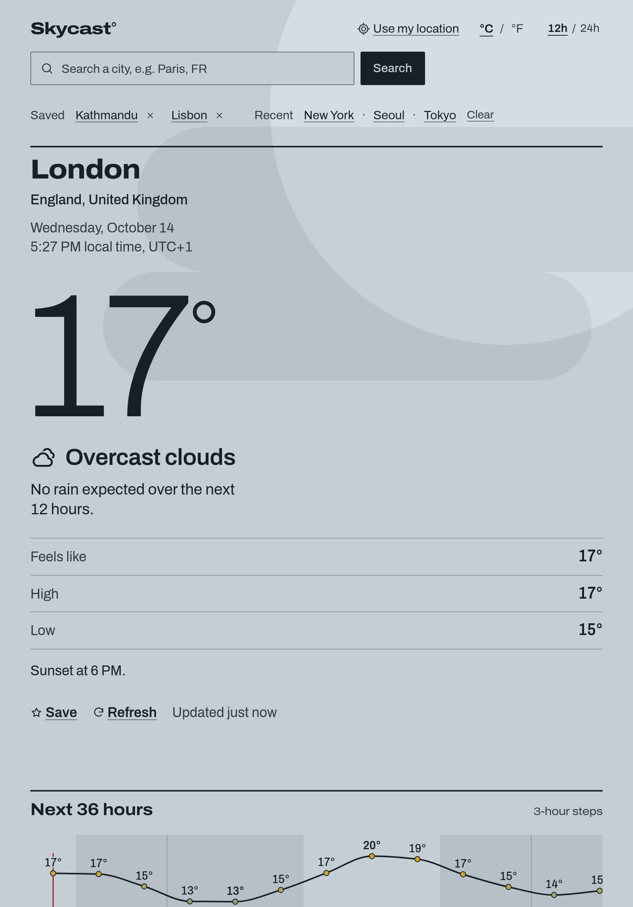
  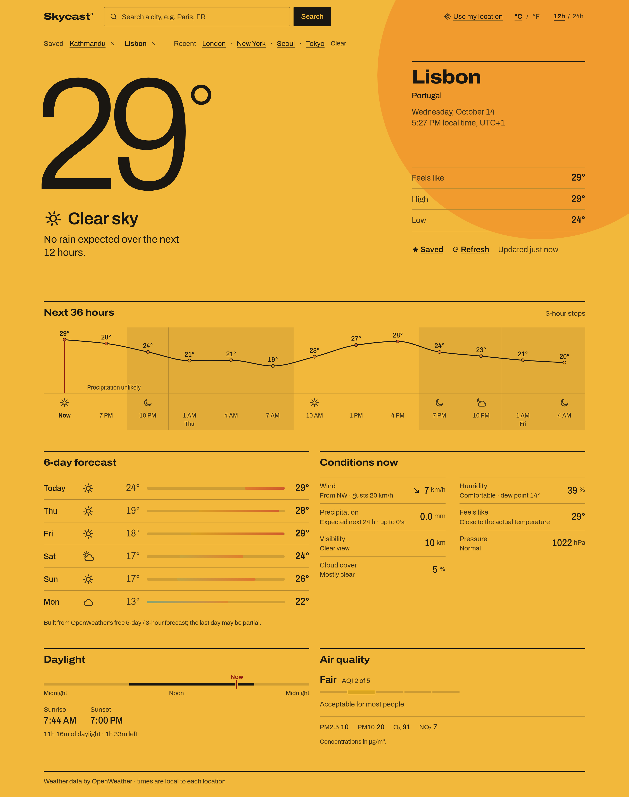
</p>

</details>

## Features

**Forecast**

- Current temperature, feels-like, today's high and low, and a plain-language headline derived from the data ("Rain likely around 9 PM (100% chance)")
- A 36-hour meteogram in 3-hour steps: temperature curve, precipitation-chance bars, shaded night hours, and condition icons only where the weather changes
- A 5–6 day table with range bars on one shared scale, so days can be compared at a glance
- Wind (speed, gusts, direction), humidity and dew point, precipitation, visibility, pressure and cloud cover
- Daylight on a 24-hour bar with sunrise, sunset and time remaining, plus air quality (AQI 1–5 with PM2.5, PM10, O₃ and NO₂)
- All times in the searched location's local time; °C / °F and 12h / 24h toggles

**Search and places**

- Debounced city suggestions with full keyboard support (↑ ↓ Enter Esc), plus free-text search such as `Paris, FR`
- Saved cities, recent searches and preferences kept in `localStorage`; the last city reopens on your next visit
- Current location only when you press the button. Permission is never requested automatically, and denial is handled gracefully

**Built to be reliable**

- Stale-response protection: a newer search cancels the older request, so a slow reply can never overwrite the latest result
- A 10-minute in-memory cache (OpenWeather's own update interval) and auto-refresh when you return to a stale tab
- Clear messages for unknown cities, offline, rate limits and invalid keys. If the forecast or air-quality call fails, current conditions still show

**Accessible**

- Primary text at least 8:1 and secondary text at least 7:1 contrast on every palette, with nothing smaller than 14px
- An ARIA combobox for search, labelled weather glyphs, a screen-reader table behind the chart, visible focus and 44px touch targets
- `prefers-reduced-motion` freezes every animation

## Getting started

You need Node.js 20.19+ (or 22.12+) and a free [OpenWeather API key](https://home.openweathermap.org/api_keys).

```bash
git clone https://github.com/Binamra7/weather-app.git
cd weather-app
npm install
cp .env.example .env.local    # then paste your key into .env.local
npm run dev                   # http://localhost:3000
```

```dotenv
# .env.local
VITE_OPENWEATHER_API_KEY=your_key_here
```

> [!NOTE]
> `VITE_*` variables are embedded in the JavaScript bundle at build time, so a deployed key is readable by anyone. That's unavoidable in a frontend-only app. Use a free-tier key, watch its usage, and never commit it. New keys can take a couple of hours to activate. Without a key, the app shows setup instructions instead of failing.

<details>
<summary><b>Scripts</b></summary>
<br />

| Command              | What it does                                   |
| -------------------- | ---------------------------------------------- |
| `npm run dev`        | Dev server on port 3000                        |
| `npm run build`      | Type-check and build static files to `dist/`   |
| `npm run preview`    | Serve the production build locally             |
| `npm test`           | Unit and integration tests (Vitest)            |
| `npm run test:watch` | Tests in watch mode                            |
| `npm run lint`       | ESLint                                         |
| `npm run typecheck`  | TypeScript project check                       |
| `npm run format`     | Format with Prettier (`format:check` verifies) |

</details>

<details>
<summary><b>Deploying</b></summary>
<br />

`npm run build` produces a static site in `dist/` that any static host can serve (Vercel, Netlify, GitHub Pages, Cloudflare Pages, S3). Set `VITE_OPENWEATHER_API_KEY` in the host's build environment. On Vercel, use the **Vite** framework preset (build command `npm run build`, output directory `dist`).

</details>

## How it works

Skycast is entirely client-side. The browser calls OpenWeather directly, and every endpoint used is on the **free plan**:

| Endpoint                      | Used for                                                    |
| ----------------------------- | ----------------------------------------------------------- |
| `GET /data/2.5/weather`       | Current conditions, sunrise and sunset, UTC offset          |
| `GET /data/2.5/forecast`      | 5-day / 3-hour forecast (the meteogram and the daily table) |
| `GET /data/2.5/air_pollution` | Current air quality                                         |
| `GET /geo/1.0/direct`         | Search suggestions                                          |
| `GET /geo/1.0/reverse`        | Naming your current location                                |

A search costs three requests: current conditions first, then the forecast and air quality in parallel. Responses are normalised once into metric, typed domain objects (`src/lib/normalize.ts`), and units are converted only at display time.

```
src/
  api/          OpenWeather client: typed errors, cancellation, raw response types
  lib/          normalisation, condition → palette mapping, units and time formatting, insights, storage
  hooks/        useWeather (stale-response protection + cache), useStoredState, useNow, useElementWidth
  components/   CurrentHero (the poster), HourlyForecast (meteogram), DailyForecast, Details,
                SearchBar, PlacesBar, Backdrop (overprinted weather marks), WeatherIcon, States
  styles/       design tokens (one ink set per sky) and global primitives
  test/         test setup and fixtures modelled on real API responses
```

<details>
<summary><b>Free-plan limitations</b></summary>
<br />

- **No UV index, and no true hourly or daily forecasts.** Those come from One Call 3.0, which needs a separate subscription. The meteogram uses 3-hour steps, and daily highs and lows are aggregated from them, so the last day may be partial.
- **Today's high and low** combine the current reading with today's remaining forecast slots. The current-weather `temp_min`/`temp_max` fields describe the spread across a city's stations right now, not the day's range.
- **Local times** use OpenWeather's fixed UTC offset per location, so a forecast that crosses a daylight-saving change can be off by an hour around the switch.

</details>

## Design

The full system lives in [`DESIGN.md`](DESIGN.md), and the tokens are in [`src/styles/tokens.css`](src/styles/tokens.css). In short:

- **Field and inks:** each of the 11 conditions (× day/night) defines a field colour and a small set of inks. The whole page re-inks itself when the sky changes, and every text pairing is checked against WCAG contrast.
- **Type:** one variable typeface, [Archivo](https://fonts.google.com/specimen/Archivo), self-hosted, using its width and weight axes: expanded and heavy for the wordmark and city, light at poster scale for the temperature, condensed for numbers.
- **Grid:** 12 columns. The reading takes columns 1–8, and the place and facts sit in a narrow column at 9–12. Heavy 2px rules open each section, and nothing is boxed.
- **Weather marks:** flat sun and moon discs, cloud shapes, rain hatching, snow, fog bands and lightning, overprinted behind the page in tints of the current ink.

## Testing

```bash
npm test
```

50 tests cover:

- unit formatting and timezone handling
- condition mapping and the daily aggregation
- API error mapping, including a check that the key never leaks into error messages
- the main user flows against a mocked API: search, unit switching and persistence, favourites, failed searches, out-of-order responses and denied geolocation

## Acknowledgements

- Weather, forecast, air-quality and geocoding data by [OpenWeather](https://openweathermap.org/)
- [Archivo](https://github.com/Omnibus-Type/Archivo) by Omnibus-Type, under the SIL Open Font License
- Visual approach informed by Dark Sky's meteogram ideas and the Swiss / International Typographic Style
